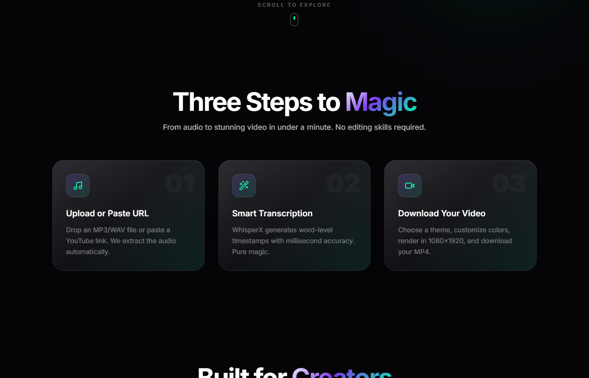

# LifeAdmin MCP

**Production-grade MCP server and REST API for visa/immigration document management. Supports any country, any visa type, any applicant profile.**

---

## What is this?

LifeAdmin is a document management system for visa and immigration applications. It provides a REST API for auth, applications, documents, and status tracking, plus an MCP server with 14 tools via stdio protocol.

## Quick Start

### Docker (recommended)
`ash
docker compose up -d
docker compose --profile setup run migrate
`

**http://localhost:3000** - API docs at **http://localhost:3000/docs**

### Manual
`ash
npm install
cp .env.example .env
npx prisma migrate deploy
npm run dev
`

## Screenshots

| Landing Page | Theme Selection |
|:---:|:---:|
|  |  |

## GitHub Pages

A live demo is available at: **https://shashwat1729.github.io/lyricreel/**

> Note: The backend API is not available on GitHub Pages, so the upload and render features require running locally.

## Environment Variables

| Variable | Required | Default | Description |
|----------|----------|---------|-------------|
| DATABASE_URL | Yes | - | PostgreSQL connection string |
| JWT_SECRET | Yes | - | Min 32 chars. Generate: openssl rand -base64 64 |
| REDIS_URL | Yes | redis://localhost:6379 | Redis connection |
| PORT | No | 3000 | Server port |
| UPLOAD_DIR | No | ./uploads | File upload directory |
| MAX_FILE_SIZE | No | 52428800 | Max upload size (50MB) |
| OCR_SERVICE_URL | For OCR | - | Python OCR service |
| PDF_SERVICE_URL | For PDF | - | Python PDF service |
| ALLOWED_ORIGINS | No | http://localhost:3000 | CORS origins |

## Architecture

`
├── src/                 # Fastify REST API + MCP server
├── prisma/              # Database schema + migrations
├── python-services/     # OCR, PDF, classifier microservices
├── docker/              # Docker configs
├── tests/               # Test suites
└── uploads/             # Uploaded documents
`
"@

[System.IO.File]::WriteAllText("D:\personal\projects\LifeAdmin_mcp\README.md", # InstaBot - Multi-Account Instagram AI DM Chatbot

**Autonomous, lightweight, near-free Instagram DM chatbot that manages multiple accounts with isolated AI personalities.**

---

## What is this?

InstaBot runs 4-10 Instagram accounts simultaneously, each with its own AI personality. It auto-replies to DMs, remembers conversations, handles payments, and costs near zero to run (Groq FREE tier + local replies).

## Features

- **Multi-Account** - Manage 4-10 Instagram accounts at once
- **AI Personalities** - Hot-reloadable persona per account
- **Near-Zero Cost** - Groq FREE tier covers most messages
- **Secure** - Webhook signature verification, jailbreak detection
- **Payment Monetization** - Razorpay integration with free trial + paid credits
- **Image Generation** - AI images via Tensor.art API
- **Demo Mode** - Test without Instagram API

## Quick Start

### Prerequisites
- Python 3.11+

### Setup
`ash
cd backend
cp .env.example .env
python -m venv venv && source venv/bin/activate
pip install -r requirements.txt
python run.py
`

**http://localhost:8000**

Set DEMO_MODE=true in .env to test without Instagram.

## Screenshots

| Landing Page | Theme Selection |
|:---:|:---:|
|  |  |

## GitHub Pages

A live demo is available at: **https://shashwat1729.github.io/lyricreel/**

> Note: The backend API is not available on GitHub Pages, so the upload and render features require running locally.

## Environment Variables

Copy ackend/.env.example to ackend/.env:

| Variable | Required | Description |
|----------|----------|-------------|
| OPENROUTER_API_KEY | Yes | AI API key (openrouter.ai/keys) |
| GROQ_API_KEY | Recommended | Free AI inference (console.groq.com) |
| INSTAGRAM_APP_SECRET | Yes | Webhook verification |
| RAZORPAY_KEY_ID | For payments | Razorpay merchant key |
| RAZORPAY_KEY_SECRET | For payments | Razorpay merchant secret |
| TENSOR_ART_API_KEY | Optional | Image generation |
| DEMO_MODE | No | true to run without Instagram API |, System.Text.UTF8Encoding)
Write-Output "lifeadmin-mcp README fixed"

# LYRICREEL
# InstaBot - Multi-Account Instagram AI DM Chatbot

**Autonomous, lightweight, near-free Instagram DM chatbot that manages multiple accounts with isolated AI personalities.**

---

## What is this?

InstaBot runs 4-10 Instagram accounts simultaneously, each with its own AI personality. It auto-replies to DMs, remembers conversations, handles payments, and costs near zero to run (Groq FREE tier + local replies).

## Features

- **Multi-Account** - Manage 4-10 Instagram accounts at once
- **AI Personalities** - Hot-reloadable persona per account
- **Near-Zero Cost** - Groq FREE tier covers most messages
- **Secure** - Webhook signature verification, jailbreak detection
- **Payment Monetization** - Razorpay integration with free trial + paid credits
- **Image Generation** - AI images via Tensor.art API
- **Demo Mode** - Test without Instagram API

## Quick Start

### Prerequisites
- Python 3.11+

### Setup
`ash
cd backend
cp .env.example .env
python -m venv venv && source venv/bin/activate
pip install -r requirements.txt
python run.py
`

**http://localhost:8000**

Set DEMO_MODE=true in .env to test without Instagram.

## Screenshots

| Landing Page | Theme Selection |
|:---:|:---:|
|  |  |

## GitHub Pages

A live demo is available at: **https://shashwat1729.github.io/lyricreel/**

> Note: The backend API is not available on GitHub Pages, so the upload and render features require running locally.

## Environment Variables

Copy ackend/.env.example to ackend/.env:

| Variable | Required | Description |
|----------|----------|-------------|
| OPENROUTER_API_KEY | Yes | AI API key (openrouter.ai/keys) |
| GROQ_API_KEY | Recommended | Free AI inference (console.groq.com) |
| INSTAGRAM_APP_SECRET | Yes | Webhook verification |
| RAZORPAY_KEY_ID | For payments | Razorpay merchant key |
| RAZORPAY_KEY_SECRET | For payments | Razorpay merchant secret |
| TENSOR_ART_API_KEY | Optional | Image generation |
| DEMO_MODE | No | true to run without Instagram API | = @"
# LyricReel

**Generate stunning lyric videos for YouTube Shorts, Instagram Reels, and TikTok - powered by AI.**

---

## What is this?

Upload a song, AI transcribes lyrics with word-level timestamps, and Remotion renders a cinematic vertical video with synced karaoke-style animation. Ready for Shorts, Reels, TikTok. No paid APIs required.

## Features

- **Automatic Transcription** - WhisperX generates word-level timestamps locally
- **6 Visual Themes** - Neon, Anime, Sad, Synthwave, Minimalist, Cinematic
- **Vertical Video** - 1080x1920, optimized for Shorts/Reels/TikTok
- **Preview Player** - See lyrics synced to audio before rendering
- **Multiple Formats** - MP3/WAV input, MP4 H.264 output
- **No Paid APIs** - Everything runs locally with open-source tools

## Quick Start

### Prerequisites
- Node.js 18+, Python 3.9+, FFmpeg
- WhisperX: pip install whisperx

### Setup
`ash
npm run install:all
npm run setup
npm run dev
`

Frontend: **http://localhost:3000**
Backend: **http://localhost:3001**

## Screenshots

| Landing Page | Theme Selection |
|:---:|:---:|
|  |  |

## GitHub Pages

A live demo is available at: **https://shashwat1729.github.io/lyricreel/**

> Note: The backend API is not available on GitHub Pages, so the upload and render features require running locally.

## Environment Variables

Copy .env.example to .env:

| Variable | Default | Description |
|----------|---------|-------------|
| PORT | 3001 | Backend port |
| NEXT_PUBLIC_API_URL | http://localhost:3001 | Frontend API URL |
| WHISPERX_MODEL_SIZE | base | tiny, base, small, medium, large |
| WHISPERX_DEVICE | cpu | cpu or cuda |
| UPLOAD_DIR | ./uploads | Upload directory |
| RENDER_DIR | ./renders | Output directory |

## Themes

| Theme | Vibe |
|-------|------|
| Neon | Cyberpunk glow, pink/blue gradients |
| Anime | Soft pastels, floaty vibes |
| Sad | Muted tones, melancholy |
| Synthwave | Retro 80s, purple/orange sunsets |
| Minimalist | Clean typography, monochrome |
| Cinematic | Letterbox bars, dramatic serif fonts |