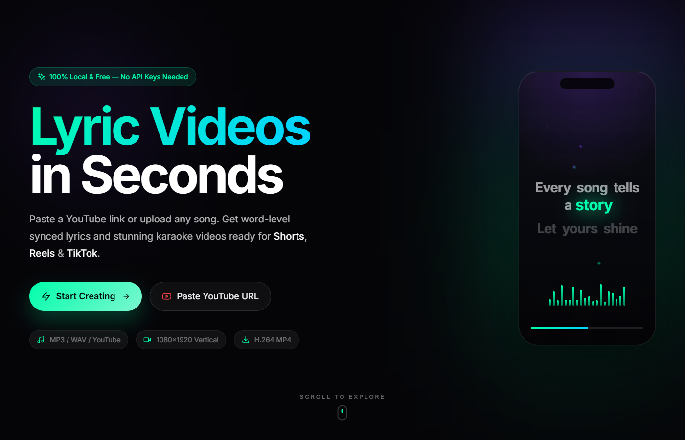

# LyricReel

**Generate lyric videos for YouTube Shorts, Instagram Reels, and TikTok.**

Upload a song, AI transcribes lyrics with word-level timestamps, and renders a vertical video with synced karaoke animation. Everything runs locally, no paid APIs.

## Screenshots

| Landing | Theme Selection |
|:---:|:---:|
|  |  |

## Quick Start

- Python 3.9+, Node.js 18+, FFmpeg required
- Install WhisperX: pip install whisperx

`
npm run install:all && npm run setup && npm run dev
`

Frontend on **:3000**, Backend on **:3001**.

## Environment

| Variable | Default | What |
|----------|---------|------|
| PORT | 3001 | Backend port |
| WHISPERX_MODEL_SIZE | base | tiny / base / small / medium / large |
| WHISPERX_DEVICE | cpu | cpu or cuda |

## Themes

Neon · Anime · Sad · Synthwave · Minimalist · Cinematic